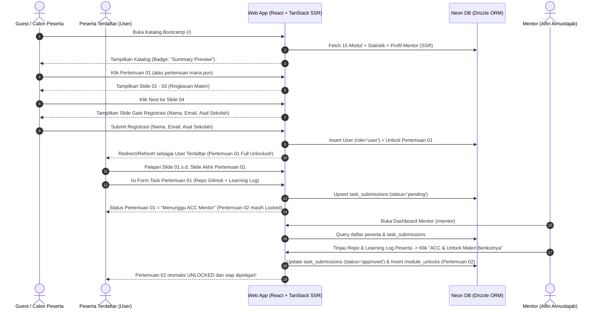

# Product Design Document (PDD)
## Digitek Software Engineering Bootcamp — Interactive Slide & Task-Gated Learning

| Informasi Dokumen | Detail |
| :--- | :--- |
| **Produk** | Digitek Software Engineering Bootcamp Platform (Batch 1) |
| **Perusahaan** | PT. Digital Teknologi Perkasa |
| **Mentor Utama** | Alfin Almustajab (*Front-End Developer • Nuxt Specialist • AI Integrator*) |
| **Fokus Desain Produk** | Pengalaman Belajar Berbasis Slide (Slide-First UX) & Progressive Unlock Berbasis ACC Task Mentor |
| **Versi** | 1.0.0 |

---

## 1. Filosofi Desain Produk

Website bootcamp ini dirancang dengan filosofi **"Belajar Konsep Lewat Visual Slide yang Ringkas, Buktikan Pemahaman Lewat Praktik Kode"**:

1. **Slide-First Learning (Bukan Dinding Teks Panjang)**:
   Peserta PKL/Intern pemula sering kewalahan ketika membaca dokumen silabus ribuan baris. Dengan memecah setiap pertemuan menjadi **slide-slide fokus** (mirip pengalaman `bootcamp.halopolca.my.id/Fundamental Desain.html` dan presentasi Apple Keynote), satu layar hanya menyampaikan **satu ide utama**, dilengkapi diagram, perbandingan *Salah vs Benar (Bad vs Good Code)*, dan langkah praktik bertahap.
2. **Try Before Register, Commit to Unlock**:
   - Siapa pun yang membuka website dapat langsung merasakan kualitas slide melalui **Materi Ringkasan (Summary Preview)** di setiap modul.
   - Ketika peserta tertarik melanjutkan ke materi teknis mendalam, mereka mendaftar hanya dengan **3 data inti**: **Nama Lengkap**, **Email**, dan **Asal Sekolah**.
3. **Mastery-Based Progression (Unlock Setelah Di-ACC Mentor)**:
   Sesuai prinsip utama silabus (*"Learn the concept, build the feature, understand the code, and explain the result"*), peserta tidak bisa sekadar mengklik tombol "Next Module" untuk menamatkan bootcamp. Mereka wajib menyelesaikan *Task* pertemuan tersebut, mengunggah tautan GitHub & *Learning Log*, dan mendapatkan **ACC dari Mentor Alfin Almustajab**.

---

## 2. Peta Perjalanan Pengguna (User Journey Map)

---

## 3. Struktur Modul & Konten Slide (15 Pertemuan + 2 Modul Pendamping)

Setiap pertemuan dari ke-4 dokumen silabus `BATCH 1` distandarisasi ke dalam struktur slide berikut agar konsisten dan mudah diikuti:

### 3.1. Zona Slide Ringkasan (`isSummary: true` — Terbuka untuk Guest & User)
- **Slide 01 — Cover & Identitas Pertemuan**: Judul pertemuan, bulan ke-N, jenis sesi (*Kickoff / Materi / Praktik / Project Clinic / Evaluasi*), target output, dan badge mentor **Alfin Almustajab**.
- **Slide 02 — Mengapa Materi Ini Penting (Executive Summary)**: Ringkasan masalah yang diselesaikan pada pertemuan ini dan hubungannya dengan evolusi project **TaskFlow** & **InternFlow**.
- **Slide 03 — Peta Konsep & Agenda Sesi (30% Teori / 70% Praktik)**: Bento grid 4–6 poin materi inti yang akan dibahas beserta estimasi pembagian waktu 2–3 jam.

### 3.2. Zona Slide Materi Inti & Praktik (`isSummary: false` — Wajib Register & Unlocked)
- **Slide 04 — Analogi & Konsep Fundamental**: Penjelasan visual ramah pemula (contoh: model Client-Server, Box Model CSS, DOM Tree, REST API Request-Response, Reactivity Vue, Nuxt Server Engine Nitro).
- **Slide 05 — Bedah Teknis & Sintaks Inti**: Penjelasan kode dan arsitektur dengan kartu Bento ber-dot macOS.
- **Slide 06 — Good Practice vs Bad Practice (Salah vs Benar)**: Slide perbandingan dua kolom ala `Fundamental Desain.html` (Kolom Kiri Merah `✕ Kesalahan Pemula` vs Kolom Kanan Hijau `✓ Standar Software Engineer`).
- **Slide 07 — Langkah Praktik Project-Based Learning (70% Hands-On)**: Panduan langkah demi langkah membangun fitur **TaskFlow / InternFlow** pada pertemuan tersebut, dilengkapi perintah terminal dan struktur kode.
- **Slide 08 — Kuis Evaluasi Pemahaman & Referensi Free Programming Books**: Daftar pertanyaan uji pemahaman (dengan tombol *Lihat Kunci Konsep*) serta tautan bacaan gratis Bahasa Indonesia & Inggris dari plugin `learning`.
- **Slide 09 — Tugas Pertemuan (Task) & Form Pengumpulan Learning Log**: Spesifikasi *deliverable* wajib, *Weekly Coding Assignment*, dan formulir interaktif pengumpulan tugas untuk di-ACC oleh Mentor.

---

## 4. Desain Pengalaman Role Mentor (Mentor Control Center)

Mentor (**Alfin Almustajab**) membutuhkan antarmuka yang cepat saat mendampingi puluhan siswa PKL dari berbagai SMK/Universitas:

1. **Filter & Pencarian Peserta**: Filter berdasarkan asal sekolah, status pengumpulan task (*Menunggu ACC*, *Perlu Revisi*, *Disetujui*), atau pertemuan tertentu.
2. **One-Click ACC & Feedback**:
   - Mentor dapat melihat *Learning Log* peserta (apa yang dipelajari, kendala yang dihadapi, cara mengatasi, dan tautan commit GitHub) langsung di kartu review.
   - Satu klik pada tombol **"ACC & Buka Materi Berikutnya"** langsung menyetujui tugas sekaligus membuka kunci pertemuan selanjutnya (`N+1`).
   - Jika kode atau repository peserta belum sesuai standar (misalnya belum menggunakan *semantic HTML* atau *parameterized query*), mentor dapat menuliskan catatan di kolom feedback dan menekan **"Minta Revisi"**.
3. **Matrix Progress 15 Pertemuan**:
   - Tabel visual yang menampilkan baris peserta dan 15 kolom indikator pertemuan (`1` s.d. `15`), sehingga mentor dapat langsung melihat siapa peserta yang melaju cepat dan siapa yang tertinggal serta membutuhkan sesi *Project Clinic / Buffer*.

---

## 5. Profil Mentor Terintegrasi (Dari Obsidian Memory Vault)

Di halaman utama katalog (`#tentang`) dan di kartu informasi mentor pada setiap slide deck, ditampilkan profil lengkap mentor yang ditarik akurat dari *Obsidian Memory Vault*:

- **Nama**: Alfin Almustajab
- **Jabatan & Peran**: Front-End Developer & IT Support di **PT. Digital Teknologi Perkasa** (`COMP-DTP-001`) • Tim Digital Marketing & Pendamping Yayasan di **Divisi Pesantren Smart Digital** (`DIV-PSD-001`) • Lead Mentor Software Engineering Bootcamp Batch 1.
- **Spesialisasi**: `Nuxt Specialist` • `Vue 3` • `TypeScript` • `Tailwind CSS` • `Supabase & MySQL` • `AI & RAG Integrator (Gemini, OpenRouter, Vision AI)`.
- **Tagline**: *"Membangun web modern dengan Nuxt, terhubung data via Supabase, dan diperkaya integrasi AI."*
- **Rekam Jejak Proyek Nyata (Studi Kasus bagi Peserta Bootcamp)**:
  1. **CoupleCash (2026)** — Aplikasi manajemen keuangan pasangan dengan *AI Financial Assistant* & *Vision AI Receipt Scanner* (Nuxt 4, Vue 3, TypeScript, Tailwind).
  2. **Digitek Corporate Web (2025)** — Website resmi & Admin Panel PT. Digital Teknologi Perkasa (Vue, Nuxt, Tailwind, Supabase).
  3. **E-Lapak Pontren (2025)** — Platform E-Commerce UMKM Pondok Pesantren berstandar aksesibilitas *WCAG 2.2 AA*.
  4. **Katalog Website PPDB Pesantren Smart Digital (2026)** — Etalase solusi PPDB interaktif dengan Nuxt, Vue, Nitro, dan **Neon Serverless Postgres**.
  5. **Gateway Pemesanan Padang & Web PPDB Yayasan** — Implementasi nyata HTML, CSS/Tailwind, dan JavaScript.
- **Kontak & Portofolio**:
  - Website: [allfine.my.id](https://allfine.my.id) / [agenthealfin.my.id](https://agenthealfin.my.id) / [portfolio-alfin-six.vercel.app](https://portfolio-alfin-six.vercel.app)
  - WhatsApp: [+62 857-8982-4597](https://wa.me/6285789824597)
  - Email: `kangalfin95@gmail.com`
  - Resume/CV: [Alfin-Almustajab-CV.pdf](https://allfine.my.id/Alfin-Almustajab-CV.pdf)
