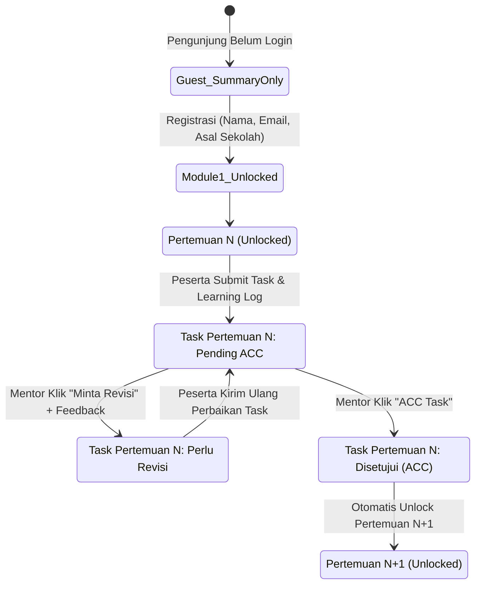

# Software Requirements Specification (SRS)
## Digitek Software Engineering Bootcamp Platform — Batch 1

| Identitas Dokumen | Detail |
| :--- | :--- |
| **Judul Sistem** | Digitek Software Engineering Bootcamp LMS & Slide Deck Platform |
| **Penyelenggara** | PT. Digital Teknologi Perkasa |
| **Mentor Utama** | Alfin Almustajab |
| **Stack Implementasi** | React 19, TanStack Router, TanStack Query (SSR Hydration), Express SSR Server, Drizzle ORM, Neon Serverless PostgreSQL |
| **Versi Spesifikasi** | 1.0.0 |

---

## 1. Pendahuluan

### 1.1. Tujuan Dokumen
Dokumen **Software Requirements Specification (SRS)** ini mendefinisikan secara lengkap kebutuhan fungsional (*Functional Requirements*), kebutuhan non-fungsional (*Non-Functional Requirements*), aturan kontrol akses berbasis peran (*Role-Based Access Control*), aturan mesin status pembukaan materi (*Progressive Unlock State Machine*), serta kontrak API untuk platform **Digitek Software Engineering Bootcamp Batch 1**.

### 1.2. Ruang Lingkup Sistem
Sistem adalah aplikasi web berbasis **Server-Side Rendering (SSR)** yang menyajikan 15 modul pertemuan (beserta modul panduan kurikulum & pustaka referensi) dalam format **slide deck interaktif**, dilengkapi sistem registrasi peserta, pengumpulan tugas (*task & learning log*), serta **Dashboard Mentor** untuk memverifikasi dan meng-ACC tugas peserta sebagai syarat membuka kunci materi berikutnya.

---

## 2. Spesifikasi Kebutuhan Fungsional (Functional Requirements)

### 2.1. Manajemen Autentikasi & Role (`FR-AUTH`)

| ID | Kebutuhan Fungsional | Prioritas |
| :--- | :--- | :---: |
| **FR-AUTH-01** | Sistem harus mendukung **2 Role terdaftar** di dalam database: `user` (Peserta Bootcamp) dan `mentor` (Alfin Almustajab), ditambah status tidak login sebagai `guest`. | **Wajib (P0)** |
| **FR-AUTH-02** | Sistem harus menyediakan formulir registrasi peserta (`role: user`) yang mewajibkan 3 atribut: **Nama Lengkap (`name`)**, **Email (`email`)**, dan **Asal Sekolah/Instansi (`schoolOrigin`)**. | **Wajib (P0)** |
| **FR-AUTH-03** | Saat peserta baru berhasil registrasi (atau masuk kembali menggunakan email yang sudah terdaftar), sistem menyimpan sesi pengguna dan secara otomatis membuka akses penuh (`Unlocked`) untuk **Pertemuan 01**. | **Wajib (P0)** |
| **FR-AUTH-04** | Sistem harus menyediakan mekanisme login/switch ke akun **Mentor (`Alfin Almustajab`, `role: mentor`)** agar mentor dapat mengakses Dashboard Mentor (`/mentor`) dan melihat seluruh slide tanpa terkunci. | **Wajib (P0)** |

### 2.2. Katalog Materi & Pembatasan Akses Bertahap (`FR-LOCK`)

| ID | Kebutuhan Fungsional | Prioritas |
| :--- | :--- | :---: |
| **FR-LOCK-01** | **Mode Guest (Belum Register)**: Pengunjung yang belum registrasi hanya dapat mengakses **Slide Ringkasan (`isSummary = true`, Slide 1–3)** pada setiap pertemuan. Seluruh slide materi detail (`isSummary = false`) harus disembunyikan di balik *Gate Registrasi*. | **Wajib (P0)** |
| **FR-LOCK-02** | **Mode User Terdaftar — Unlock Awal**: Peserta yang sudah registrasi otomatis mendapatkan akses penuh ke seluruh slide dan form task pada **Pertemuan 01** (serta modul referensi umum/kurikulum). | **Wajib (P0)** |
| **FR-LOCK-03** | **Mode User Terdaftar — Sequential Lock**: Untuk pertemuan `N` (dengan `N >= 2`), materi lengkap dan form task harus berstatus **`Locked`** kecuali salah satu syarat berikut terpenuhi: (a) Task peserta pada pertemuan `N - 1` telah berstatus **`approved` (Di-ACC oleh Mentor)**, atau (b) Mentor telah memberikan *manual unlock* untuk peserta tersebut pada pertemuan `N`. | **Wajib (P0)** |
| **FR-LOCK-04** | **Mode Mentor**: Pengguna dengan `role = 'mentor'` bebas mengakses seluruh slide pada seluruh pertemuan (1 s.d. 15) tanpa pembatasan lock. | **Wajib (P0)** |

### 2.3. Slide Deck Engine & UI Apple macOS (`FR-SLIDE`)

| ID | Kebutuhan Fungsional | Prioritas |
| :--- | :--- | :---: |
| **FR-SLIDE-01** | Setiap halaman pertemuan harus disajikan dalam bentuk **Slide Deck Interaktif** seperti `Fundamental Desain.html` dengan navigasi tombol `Prev` / `Next`, indikator `01 / XX`, *progress bar*, *keyboard navigation* (`ArrowLeft`, `ArrowRight`, `Space`), dan *mobile swipe*. | **Wajib (P0)** |
| **FR-SLIDE-02** | Setiap frame slide dan setiap kartu komponen di dalam slide maupun katalog wajib menampilkan **3 dot merah, kuning, hijau ala Apple macOS** di pojoknya serta menggunakan font **Plus Jakarta Sans** & sistem *sans-serif* Apple. | **Wajib (P0)** |
| **FR-SLIDE-03** | Materi slide harus mencakup seluruh 15 pertemuan dari ke-4 file silabus `.md` di folder `BATCH 1` (Bulan 1 Front-End, Bulan 2 Back-End/REST API/MySQL, Bulan 3 Vite/Vue 3/TypeScript/Nuxt.js), termasuk perbandingan *Good vs Bad Code*, langkah praktik *TaskFlow & InternFlow*, kuis evaluasi, serta referensi *Project-Based Learning* dan *Free Programming Books*. | **Wajib (P0)** |

### 2.4. Pengumpulan Task & Learning Log Peserta (`FR-TASK`)

| ID | Kebutuhan Fungsional | Prioritas |
| :--- | :--- | :---: |
| **FR-TASK-01** | Pada pertemuan yang telah `Unlocked`, peserta (`role: user`) dapat mengirimkan **Task Submission** yang terdiri dari: **URL Repository / Commit GitHub (`repoUrl`)**, **URL Demo / Catatan Output (`demoUrl`)**, dan **Catatan Learning Log (`learningLog`)** sesuai format silabus. | **Wajib (P0)** |
| **FR-TASK-02** | Saat peserta mengirimkan task, status submission disimpan ke database sebagai **`pending`** (*Menunggu ACC Mentor*). Peserta dapat memperbarui kiriman task-nya apabila mentor meminta revisi (`revision`). | **Wajib (P0)** |

### 2.5. Dashboard Mentor & ACC Task (`FR-MENTOR`)

| ID | Kebutuhan Fungsional | Prioritas |
| :--- | :--- | :---: |
| **FR-MENTOR-01** | Hanya pengguna dengan `role: mentor` yang dapat mengakses halaman **Dashboard Mentor (`/mentor`)** dan memanggil endpoint mutasi mentor. | **Wajib (P0)** |
| **FR-MENTOR-02** | Mentor dapat melihat daftar seluruh peserta terdaftar beserta informasi **Nama**, **Email**, **Asal Sekolah**, dan matriks progres 15 pertemuan. | **Wajib (P0)** |
| **FR-MENTOR-03** | Mentor dapat meninjau setiap *Task Submission* peserta, menuliskan **Feedback Mentor**, dan memilih aksi **ACC / Approve (`approved`)** atau **Minta Revisi (`revision`)**. | **Wajib (P0)** |
| **FR-MENTOR-04** | Ketika Mentor menekan tombol **ACC / Approve** pada task Pertemuan `N` milik seorang peserta, sistem wajib mengubah status submission menjadi `approved` **dan secara otomatis meng-unlock Pertemuan `N + 1`** untuk peserta tersebut. | **Wajib (P0)** |
| **FR-MENTOR-05** | Mentor dapat melakukan **Manual Unlock / Lock** pertemuan tertentu untuk peserta tertentu (berguna untuk sesi *Project Clinic / Buffer*) serta memperbarui deskripsi materi/task di database. | **Tinggi (P1)** |

---

## 3. Aturan Bisnis & State Machine Pembukaan Materi

### Formula Evaluasi Status Akses Pertemuan `M` (Order Index `k` dari `1..15`) untuk Pengguna `U`:
1. Jika `U == null` (Guest):
   - `accessLevel = "SUMMARY_ONLY"` (Hanya slide dengan `isSummary == true` yang dikirimkan/ditampilkan; slide lainnya diganti dengan komponen *Registration Gate*).
2. Jika `U.role == "mentor"`:
   - `accessLevel = "FULL_ACCESS"` untuk seluruh `k in 1..15`.
3. Jika `U.role == "user"`:
   - Untuk `k == 1` (Pertemuan 01) atau modul referensi non-sekuensial (`orderIndex == 0` / `orderIndex == 16`):
     - `accessLevel = "FULL_ACCESS"`.
   - Untuk `k > 1`:
     - Cek apakah ada record `task_submissions` milik `U.id` pada modul `k - 1` dengan `status == "approved"`, **ATAU** ada record di `module_unlocks` untuk `(U.id, module[k].id)`.
     - Jika **Ya** → `accessLevel = "FULL_ACCESS"`.
     - Jika **Tidak** → `accessLevel = "LOCKED_PREV_TASK"` (Hanya slide ringkasan `isSummary == true` yang dapat dilihat, diikuti layar *Task Lock Gate* yang mengarahkan peserta menyelesaikan & meminta ACC pada Pertemuan `k - 1`).

---

## 4. Spesifikasi Kontrak API (REST / SSR Endpoints)

| Method & Endpoint | Akses Role | Request Body / Query | Response & Efek Samping |
| :--- | :---: | :--- | :--- |
| `GET /api/bootstrap` | Semua | `?userId=<id>` (atau via cookie sesi) | Mengembalikan profil user aktif, profil mentor **Alfin Almustajab**, daftar 15 pertemuan + status unlock per pertemuan untuk user tersebut. |
| `GET /api/modules/:slug` | Semua | `slug` pertemuan | Mengembalikan metadata pertemuan, daftar slide (difilter `isSummary` jika Guest/Locked), detail task, dan submission user saat ini. |
| `POST /api/auth/register` | Guest | `{ name, email, schoolOrigin }` | Membuat atau memuat akun `role: 'user'`, meng-unlock Pertemuan 01, mengembalikan token/sesi user. |
| `POST /api/auth/mentor-login` | Guest / User | `{ email, passcode }` | Masuk sebagai **Alfin Almustajab (`role: 'mentor'`)** untuk keperluan mengajar & demo review dashboard. |
| `POST /api/auth/logout` | User / Mentor | — | Menghapus sesi aktif dan kembali ke mode `Guest (Summary Only)`. |
| `POST /api/tasks/submit` | User | `{ moduleId, repoUrl, demoUrl, learningLog }` | Menyimpan/memperbarui pengumpulan task peserta dengan `status = 'pending'`. |
| `GET /api/mentor/dashboard` | Mentor | — | Mengembalikan daftar seluruh peserta, statistik progres, dan seluruh antrean `task_submissions`. |
| `POST /api/mentor/review` | Mentor | `{ submissionId, status: 'approved' \| 'revision', mentorFeedback }` | Mengubah status task peserta. Jika `approved`, otomatis memasukkan record unlock untuk pertemuan berikutnya (`N + 1`). |
| `POST /api/mentor/unlock` | Mentor | `{ userId, moduleId, unlocked: boolean }` | Membuka atau mengunci pertemuan tertentu secara manual untuk seorang peserta. |

---

## 5. Kebutuhan Non-Fungsional (Non-Functional Requirements)

1. **Server-Side Rendering (SSR) dengan React & TanStack**:
   - Request halaman pertama (`/`, `/modul/:slug`, `/mentor`) dirender di server menggunakan `ReactDOMServer.renderToString` dengan `QueryClient` (TanStack Query dehydration) dan `RouterProvider` (TanStack Router) sehingga HTML awal langsung berisi konten dan siap untuk SEO maupun hidrasi instan.
2. **Keandalan Database (Neon Serverless + Local Fallback)**:
   - Menggunakan **Drizzle ORM** dan `@neondatabase/serverless` untuk koneksi ke PostgreSQL Neon.
   - Apabila variabel lingkungan `DATABASE_URL` belum diisi pada mesin lokal saat evaluasi, lapisan repositori data secara transparan menggunakan penyimpanan JSON persisten lokal yang memiliki skema identik dengan tabel Drizzle sehingga aplikasi **tidak pernah gagal berjalan (Zero-Downtime Local & Cloud Execution)**.
3. **Kinerja & Ukuran Bundle**:
   - Transisi antar slide berjalan pada `60 FPS` menggunakan akselerasi CSS `transform` dan `opacity`.
