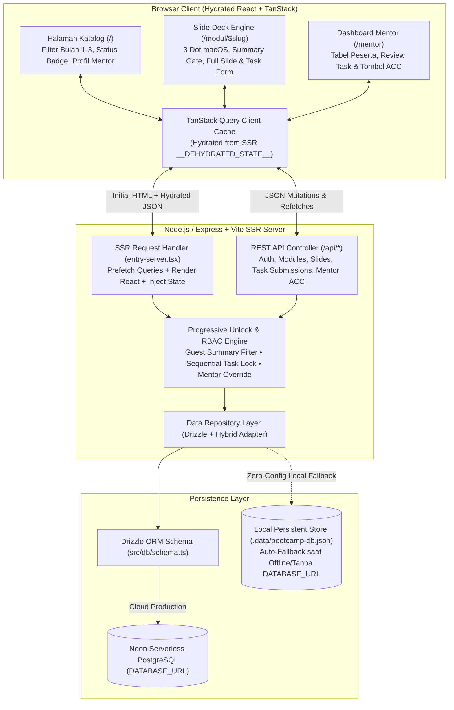
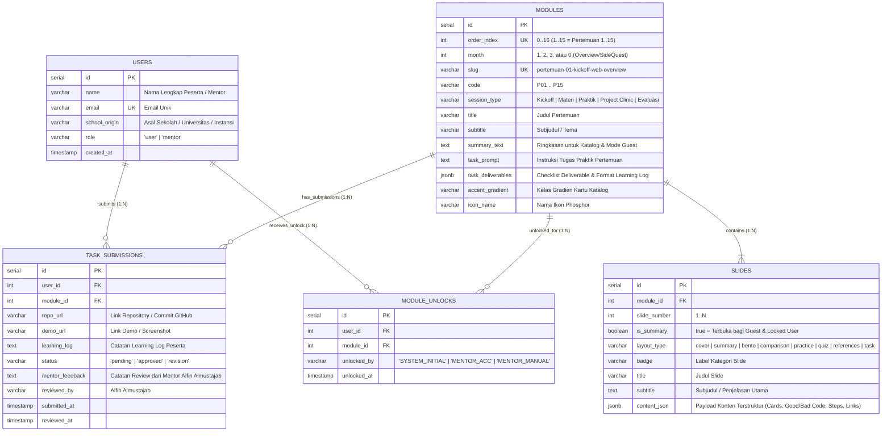

# System Design Document (`sistem design.md`)
## Digitek Software Engineering Bootcamp — React + TanStack SSR + Drizzle ORM + Neon DB

| Komponen Arsitektur | Teknologi yang Digunakan |
| :--- | :--- |
| **UI Library** | React 19 (TypeScript) |
| **Routing & SSR Hydration** | TanStack Router (`@tanstack/react-router`) + TanStack Query (`@tanstack/react-query`) |
| **SSR Runtime & Bundler** | Node.js / Express SSR Server + Vite SSR Pipeline (Package Manager: **`pnpm`**) |
| **ORM & Schema Management** | Drizzle ORM (`drizzle-orm`, `drizzle-kit`) |
| **Cloud Database** | Neon Serverless PostgreSQL (`@neondatabase/serverless`) + Local Persistent Fallback Engine |
| **Styling & Design System** | Tailwind CSS + Custom Apple macOS Glass & Traffic-Light Component Styles (`Plus Jakarta Sans`) |

---

## 1. Arsitektur Tingkat Tinggi (High-Level System Architecture)



---

## 2. Desain Skema Database (Drizzle ORM & Neon PostgreSQL)

### 2.1. Entity-Relationship Diagram (ERD)



### 2.2. Implementasi Skema Drizzle (`src/db/schema.ts`)

Skema ditulis dengan `drizzle-orm/pg-core` sehingga sepenuhnya kompatibel dengan `drizzle-kit push` / `drizzle-kit generate` ke database **Neon PostgreSQL**:

```typescript
import {
  pgTable,
  serial,
  varchar,
  text,
  integer,
  boolean,
  timestamp,
  jsonb,
  uniqueIndex,
} from 'drizzle-orm/pg-core';

export const users = pgTable('users', {
  id: serial('id').primaryKey(),
  name: varchar('name', { length: 160 }).notNull(),
  email: varchar('email', { length: 180 }).notNull().unique(),
  schoolOrigin: varchar('school_origin', { length: 200 }).notNull(),
  role: varchar('role', { length: 20 }).notNull().default('user'), // 'user' | 'mentor'
  createdAt: timestamp('created_at').defaultNow().notNull(),
});

export const modules = pgTable('modules', {
  id: serial('id').primaryKey(),
  orderIndex: integer('order_index').notNull().unique(),
  month: integer('month').notNull(),
  slug: varchar('slug', { length: 160 }).notNull().unique(),
  code: varchar('code', { length: 20 }).notNull(),
  sessionType: varchar('session_type', { length: 64 }).notNull(),
  title: varchar('title', { length: 220 }).notNull(),
  subtitle: text('subtitle').notNull(),
  summaryText: text('summary_text').notNull(),
  taskPrompt: text('task_prompt').notNull(),
  taskDeliverables: jsonb('task_deliverables').$type<string[]>().notNull(),
  accentGradient: varchar('accent_gradient', { length: 120 }).notNull(),
  iconName: varchar('icon_name', { length: 64 }).notNull(),
});
```

---

## 3. Alur Server-Side Rendering (SSR) dengan React & TanStack

1. **Incoming HTTP Request (`GET /` atau `GET /modul/:slug` atau `GET /mentor`)**:
   - Server membaca cookie sesi `bootcamp_uid` (jika pengguna sudah login sebagai `user` atau `mentor`).
   - Server membuat instance baru `QueryClient` dari `@tanstack/react-query`.
   - Server melakukan `queryClient.prefetchQuery` untuk data awal halaman (`bootstrapData` dan `moduleDetail` jika berada di rute `/modul/$slug`) langsung melalui lapisan repositori Drizzle/Neon.
2. **Server Filtering untuk Keamanan Materi Terkunci**:
   - Sebelum data slide diserialisasi ke dalam state TanStack Query SSR, `Access_Guard` memeriksa apakah pengguna berhak membuka slide lengkap (`isSummary == false`).
   - Jika pengguna adalah **Guest** atau **Peserta yang belum menyelesaikan/di-ACC task pada pertemuan sebelumnya**, server **hanya mengirimkan slide dengan `isSummary: true`** ditambah metadata status kunci (`accessStatus: 'GUEST_SUMMARY_ONLY' | 'LOCKED_PREV_TASK'`) sehingga materi penuh benar-benar terlindungi di sisi server.
3. **HTML Render & Hydration**:
   - Server mengeksekusi `renderToString` pada pohon komponen React + TanStack Router, menyuntikkan `dehydrate(queryClient)` ke `window.__TANSTACK_STATE__`, lalu mengirim HTML lengkap ke browser.
   - Di sisi browser (`entry-client.tsx`), `hydrateRoot` menghidrasi aplikasi secara mulus tanpa *flicker*.

---

## 4. Struktur Direktori Proyek

```text
BATCH 1/
├── PRD.md                                  # Product Requirements Document
├── PDD.md                                  # Product Design Document
├── Design.md                               # UI/UX & Apple macOS Slide Design System
├── SRS.md                                  # Software Requirements Specification
├── sistem design.md                        # System Architecture & Drizzle/Neon Design
├── package.json                            # Dependencies (React, TanStack, Drizzle, Neon, Express, Vite)
├── tsconfig.json                           # Konfigurasi TypeScript
├── vite.config.ts                          # Konfigurasi Vite Client & SSR Build
├── drizzle.config.ts                       # Konfigurasi Drizzle Kit untuk Neon Postgres
├── .env.example                            # Template variabel DATABASE_URL Neon
├── server.ts                               # Express SSR + REST API Server
├── index.html                              # Template HTML SSR (Plus Jakarta Sans, Phosphor Icons)
└── src/
    ├── entry-client.tsx                    # Client Hydration Entry
    ├── entry-server.tsx                    # Server SSR Entry (TanStack Query Dehydration)
    ├── router.tsx                          # TanStack Router Definitions (/, /modul/$slug, /mentor)
    ├── styles/
    │   └── app.css                         # Apple macOS Glass, 3 Traffic Dots & Slide Deck Styles
    ├── db/
    │   ├── schema.ts                       # Skema Tabel Drizzle ORM (PostgreSQL / Neon)
    │   ├── seed-data.ts                    # Data Lengkap 15 Pertemuan + Slide + Profil Alfin Almustajab
    │   └── repository.ts                   # Layanan Data Drizzle Neon + Local JSON Persistence Adapter
    └── components/
        ├── MacTrafficDots.tsx              # Komponen 3 Dot Merah Kuning Hijau ala Apple macOS
        ├── Navbar.tsx                      # Glass Navbar + Status Role & Tombol Registrasi/Mentor
        ├── RegistrationModal.tsx           # Modal Registrasi Peserta (Nama, Email, Asal Sekolah) & Login Mentor
        ├── CatalogPage.tsx                 # Halaman Katalog Bootcamp (Hero, Grid 15 Pertemuan, Roadmap, Mentor)
        ├── SlideDeckPage.tsx               # Engine Slide Interaktif + Summary Gate + Form Task Submission
        └── MentorDashboardPage.tsx         # Dashboard Mentor (Antrean ACC Task, Feedback, Matrix Peserta)
```
